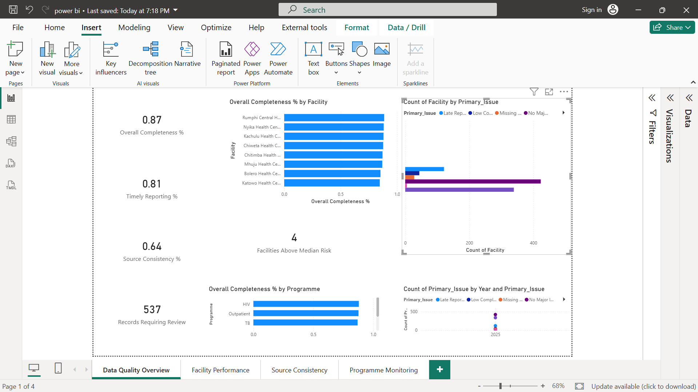
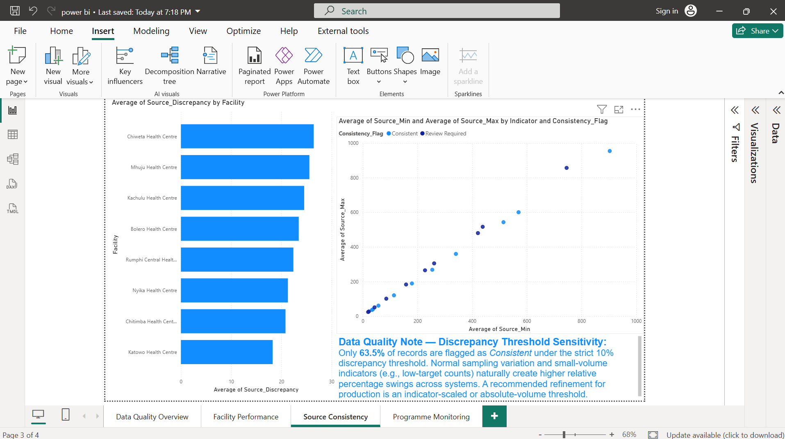

# Health Facility Data Quality Assessment & Reporting Dashboard
## Rumphi District, Malawi — Health Reporting Analytics

## Project Overview

This project demonstrates a practical data quality assessment and reporting workflow for health facilities, using a generated case-study dataset representing monthly reporting across multiple programme areas and three parallel data sources (Paper Register, EMR, DHIS2).

The analysis identifies incomplete records, inconsistencies between reporting systems, delayed reporting, unusual values, and other data-quality problems that would affect programme monitoring and decision-making in a real health information system.

Built as a portfolio demonstration for Data Technician, Data Analyst, Monitoring & Evaluation (M&E), and health informatics roles.

**All data in this project is synthetic, generated programmatically with a fixed random seed (see `notebooks/health_data_quality_analysis.ipynb`, Section 1). It does not represent actual patient, facility, or Ministry of Health data. Facility names are illustrative, chosen to be plausible for the district, not drawn from any real facility list.**

## Problem Statement

Health programmes depend on accurate, complete, and timely information for monitoring performance and supporting operational decisions. Where information is recorded across paper registers, electronic medical records, and platforms like DHIS2, differences between sources create real data-quality problems: missing values, duplicate or inconsistent records, delayed reporting, out-of-range values, and disagreement between systems. These problems make routine reporting less reliable and increase the time required for verification and correction.

This project demonstrates how a Data Technician or M&E Assistant could identify these issues systematically using Python, and present the results through a Power BI dashboard designed around an M&E Officer's actual follow-up workflow.

## Objectives

1. Assess data completeness across facilities and programme areas
2. Identify inconsistencies between paper, EMR, and DHIS2 records
3. Identify unusual or potentially erroneous reported values
4. Analyse reporting timeliness
5. Identify facilities with recurring data-quality problems
6. Analyse trends in reported indicators over time
7. Produce a prioritized, risk-ranked view to support M&E follow-up decisions
8. Demonstrate a complete, reproducible workflow from raw data to actionable output

## Dataset Design

Generated in the notebook (not sourced from anywhere): 8 fictional facilities x 12 months (2025) x 5 programme areas x 2 indicators each x information from 3 reporting sources = **960 monthly facility-indicator records**.

Programme areas: **HIV, TB, Maternal Health, Child Health, Outpatient** (two indicators each — e.g. HIV has "Patients on ART" and "New ART Initiations").

Four categories of realistic data-quality problems are deliberately injected with their own fixed random seeds, so the exact affected rows are reproducible:
- **Missing reported values** — 3% of records
- **Source discrepancies** (DHIS2 perturbed 40–60% from the other sources) — 5% of records
- **Outliers** (reported value inflated to 2–3x target) — 2% of records
- **Forced late reports** — an additional 8% of records, on top of the ~12% baseline lateness rate

No real patient-level information is included anywhere in this project.

## Tools Used

Python (Pandas, NumPy, Matplotlib, Seaborn, Plotly, Streamlit) · Jupyter Notebook · Power BI

Python is used for reproducible data generation, validation, assessment and visualisation. The repository includes the implemented Power BI report and a Streamlit companion for browser-based exploration (see [`dashboard/`](dashboard/)).

## Project Workflow

```
Raw Data → Data Inspection → Data Cleaning → Data Validation
    → Data Quality Assessment → Exploratory Analysis → Key Findings → Streamlit & Power BI Reporting
```

## Data Quality Dimensions

- **Completeness** — are required fields/records available? (`Calculated_Completeness`, calculated from actual field presence)
- **Consistency** — do the three reporting sources agree? (`Consistency_Flag`, using a 20% relative difference AND a 5-unit absolute difference threshold)
- **Timeliness** — was reporting completed on time? (`Calculated_Timeliness`, based on reporting dates vs. due dates)
- **Validity** — do reported values fall within a reasonable range? (`Outlier_Flag`, using IQR method grouped by indicator)

## Key Findings

The following figures are calculated from the committed 960-row raw dataset using the current field-presence, timeliness, hybrid consistency and IQR rules. They describe this generated dataset only; they are not real Rumphi District or Ministry of Health results.

1. **Actual field completeness is 99.5%**, calculated from the presence of six required fields rather than the generator's simulated completeness score. Timely reporting is **80.8%** (776 of 960 records).
2. **271 of 960 records (28.2%)** have at least one quality flag under the current rules. This is the distinct-record count; issue counts overlap. The individual counts are 28 missing reported values, 184 late reports, 64 source reviews and 14 IQR outliers.
3. **Source consistency is 93.3%** (896 of 960 records) using the hybrid rule: for positive source minima, a review is raised only when the relative discrepancy exceeds 20% AND the absolute difference exceeds 5 units; when the minimum is zero, the absolute tolerance applies.
4. **Timeliness varies across facilities.** Kachulu Health Centre has the lowest on-time rate (74.2%), followed by Rumphi Central Health Centre (77.5%); Katowo Health Centre has the highest (85.0%).
5. **Calculated completeness is consistently high across facilities**, ranging from approximately 99.3% to 99.7%. Chiweta and Katowo are lowest; Rumphi Central and Nyika are highest. This illustrates why completeness should be calculated from actual required-field presence rather than a separate simulated score.
6. **The rate-normalised facility risk index** ranks Kachulu highest (8.1/100), followed by Rumphi Central (6.7) and Chitimba (6.6). The score gives equal weight to completeness shortfall, late reporting, source reviews, missing values and outliers. It is a follow-up prioritisation aid, not a validated facility-performance or clinical score.

The notebook reproduces these calculations and provides the detailed facility, programme and monthly breakdowns.

## Dashboard and Outputs

The project includes two complementary dashboard experiences:

[](https://health-facility-data-quality-analysis.streamlit.app/)

**Live application:** [Health Facility Data Quality Workspace](https://health-facility-data-quality-analysis.streamlit.app/)

### Streamlit companion

- [CSV data dictionary and upload contract](docs/data_dictionary.md)
- [Operational workflow, quality rules and production-readiness gaps](docs/operational_workflow.md)

The deployed Streamlit workspace supports bundled demonstration data, a downloadable CSV upload template and user-uploaded CSV assessment with schema/value intake checks, facility and programme filters, reporting-period filtering, executive quality metrics, volume-normalised facility risk prioritisation, programme/indicator monitoring, three-source reconciliation, a multi-issue record register, corrective-action ownership/status/notes, and CSV exports. Corrective-action assignments are persisted to a local SQLite database with field-level audit history. On Streamlit Community Cloud the local filesystem is ephemeral and not shared across instances, so the register should be downloaded regularly; managed multi-user persistence is not configured.

Run locally from the repository root:

```bash
pip install -r requirements.txt
streamlit run dashboard/streamlit_app.py
```

The app prefers `data/raw/synthetic_health_facility_data.csv` and falls back to the processed export only if the raw file is unavailable. Uploaded CSVs must include Facility, Programme, Indicator, Month, Reported_Value, Target_Value, Data_Source, Paper_Value, EMR_Value and DHIS2_Value. The shared `src/reporting.py` pipeline validates the intake, normalises numeric/date fields, recalculates completeness from field presence, applies the hybrid source-consistency and IQR outlier rules, and builds facility and issue summaries. If both `Submission_Date` and `Deadline_Date` are supplied, timeliness is calculated from those actual dates; otherwise the bundled synthetic `Timeliness` field is used. Records with fewer than two available source values are marked `Unknown Sources`, not silently counted as consistent. The source-reconciliation tab explains the production hybrid threshold and its limitations. The risk index is a transparent prioritisation aid, not a validated facility-performance score.

#### Deploy on Streamlit Community Cloud

1. Sign in to [Streamlit Community Cloud](https://share.streamlit.io/) with the GitHub account that can access this repository.
2. Select **Create app**, choose this repository and the `main` branch.
3. Set the **Main file path** to `dashboard/streamlit_app.py`.
4. Deploy. Streamlit installs packages from the repository `requirements.txt`.
5. If deployment reports a missing file or dependency, use the app's **Manage app** logs to identify and resolve the issue before sharing the URL.

The repository includes automated tests for the reporting intake pipeline and a Streamlit `AppTest` smoke test in CI. These verify core logic and that the app renders without a runtime exception; they are not a substitute for a visual browser review of the deployed app.

### Power BI report

The Power BI dashboard is implemented and included in the repository:

- Power BI file: [dashboard/health_facility_data_quality_dashboard.pbix](dashboard/health_facility_data_quality_dashboard.pbix)
- Dashboard documentation: [dashboard/powerbi_dashboard_documentation.md](dashboard/powerbi_dashboard_documentation.md)
- Data Quality Overview: [dashboard/Data_Quality_Overview.png](dashboard/Data_Quality_Overview.png)
- Facility Performance: [dashboard/Facility_Performance.png](dashboard/Facility_Performance.png)
- Source Consistency: [dashboard/Source_Consistency.png](dashboard/Source_Consistency.png)
- Programme Monitoring: [dashboard/Programme_Monitoring.png](dashboard/Programme_Monitoring.png)

### Power BI report screenshots

These are existing exports of the four Power BI report pages, not screenshots of the Streamlit app.







The Python analysis and data preparation workflow is available in [notebooks/health_data_quality_analysis.ipynb](notebooks/health_data_quality_analysis.ipynb).

## Decision-Making Use Case

A Monitoring & Evaluation Officer could use the dashboard to prioritise follow-up. For example: a facility shows low completeness for HIV reporting and repeated Paper/DHIS2 disagreement. The officer could identify the affected months, review source documents, contact the responsible facility staff, correct the reporting issue, and monitor that facility in subsequent cycles. This is what turns the dashboard from a reporting tool into a data-quality monitoring tool.

## Project Structure

```
health-facility-data-quality/
├── data/
│   ├── raw/
│   │   └── synthetic_health_facility_data.csv       # As generated, before cleaning
│   └── processed/
│       └── health_facility_data_processed.csv       # Cleaned + all quality flags added
├── notebooks/
│   └── health_data_quality_analysis.ipynb           # Full reproducible analysis workflow
├── docs/
│   ├── data_dictionary.md                           # CSV schema and validation contract
│   └── operational_workflow.md                      # Assessment rules and governance notes
├── dashboard/
│   ├── health_facility_data_quality_dashboard.pbix  # Finished Power BI dashboard
│   ├── streamlit_app.py                             # Interactive Streamlit companion
│   ├── Data_Quality_Overview.png                     # Dashboard page export
│   ├── Facility_Performance.png                      # Dashboard page export
│   ├── Programme_Monitoring.png                      # Dashboard page export
│   ├── Source_Consistency.png                        # Dashboard page export
│   └── powerbi_dashboard_documentation.md           # Implementation and design guide
├── src/
│   ├── reporting.py                                  # CSV intake and reusable reporting workflow
│   ├── data_generator.py                             # Synthetic data generation module
│   └── data_quality.py                              # Data quality assessment functions
├── tests/
│   ├── test_data_quality.py                          # Automated tests for data quality rules
│   ├── test_reporting.py                              # Intake and assessment pipeline tests
│   └── test_streamlit_app.py                          # Streamlit rendering smoke test
├── visuals/
│   └── charts/                                       # Chart exports from the notebook
├── .github/workflows/quality-checks.yml             # Automated CI checks
├── .streamlit/config.toml                            # Accessible light theme
├── requirements.txt
└── README.md
```

**What belongs where:** `data/` holds the raw and processed datasets; `notebooks/` contains the reproducible analysis; `docs/` defines the upload contract and operational workflow; `dashboard/` contains the Power BI report, exports and Streamlit workspace; `src/` contains reusable data generation, assessment and reporting logic; `tests/` covers quality rules, intake/assessment behaviour and app rendering; `visuals/charts/` holds notebook chart exports.

## How to Run

Install dependencies and launch the Streamlit companion from the repository root:

```bash
pip install -r requirements.txt
streamlit run dashboard/streamlit_app.py
```

To reproduce the analysis, launch Jupyter from the repository root. The notebook resolves the project paths automatically whether it is opened from the root or the `notebooks/` directory:

```bash
git clone https://github.com/MkandawireChico/Health-facility-data-quality-analysis-using-synthetic-data-.git
cd Health-facility-data-quality-analysis-using-synthetic-data-
pip install -r requirements.txt
jupyter notebook notebooks/health_data_quality_analysis.ipynb
# Run all cells from top to bottom to regenerate the synthetic data,
# calculate quality metrics and refresh the exported charts.

# Run the automated tests from the repository root:
pytest -q
```


## Portfolio Relevance

Demonstrates skills relevant to: Data Technician · Data Analyst · Monitoring & Evaluation Assistant · Health Information Systems Assistant · M&E Data Officer · Research Data Assistant · Health Informatics roles — specifically the ability to move from raw, imperfect data to validated information and a prioritized, actionable output.

## Future Improvements

- Capture and add genuine screenshots of the deployed Streamlit app after completing a visual browser QA pass
- Validate the statistical thresholds and peer-group assumptions against appropriately governed operational data before any real-world use
- Extend the automated tests to cover the production data-quality module and end-to-end dataset generation
- If properly anonymised and aggregated operational reporting data ever becomes available for a comparable workflow, assess whether the synthetic patterns generalise

## Author

Chico Mkandawire
MSc Data Science, Malawi University of Science and Technology (in progress)
BSc Management Information Systems, Malawi University of Business and Applied Sciences


## Expanded Health Data Intelligence Platform

The project is being expanded beyond the original 960-row demonstration into a reproducible, multi-year synthetic health reporting platform. The target cohort is 120 synthetic facilities across six Malawi-oriented district labels, 60 monthly periods, eight programme areas and 40 indicators — **288,000 facility-month-indicator records**.

- [Expanded platform build blueprint](docs/data_platform_blueprint.md)
- [Scalable synthetic data generator](src/scale_data_generator.py)
- [Generator test suite](tests/test_scale_data_generator.py)

Generate the expanded cohort locally with `python src/scale_data_generator.py`. The generated fact table, facility dimension and run manifest are written under `data/warehouse/raw/`. Generated CSVs are reproducible from the fixed seed and configuration and are intentionally not committed as large generated files. All records are synthetic and do not represent actual facility performance.


### Staging and data-quality pipeline

After generating the raw cohort, run `python src/etl_pipeline.py` to normalize and stage the reporting fact against the facility dimension. Structural failures (such as unknown facilities, invalid periods and duplicate natural keys) are written to quarantine; analytical quality issues remain in the staged data with explicit flags. A JSON quality report summarizes staging yield and issue counts.

Outputs: `data/warehouse/staged/facility_reporting_staged.csv`, `facility_reporting_quarantine.csv` and `staging_quality_report.json`.

The pipeline implementation is in [src/etl_pipeline.py](src/etl_pipeline.py), with automated coverage in [tests/test_etl_pipeline.py](tests/test_etl_pipeline.py).


### Detector evaluation and longitudinal analytics

Run `python src/quality_analytics.py` after staging to evaluate the missing-value, source-discrepancy, outlier and timeliness detectors against the generator's injected-defect ground-truth labels. The evaluation reports confusion counts, precision, recall, F1, specificity, false-positive rate and accuracy. The same command writes monthly trends, facility benchmarks and programme/indicator profiles under `data/warehouse/analytics/`.

Ground-truth labels are used only to calculate evaluation metrics. Operational predictions, monthly trends and facility/programme profiles do not use those labels. Metrics describe performance against controlled injected defects, not validated performance on real health reporting data. The outlier rule is Reported_Value / Target_Value > 1.5.

Implementation: [src/quality_analytics.py](src/quality_analytics.py). Tests: [tests/test_quality_analytics.py](tests/test_quality_analytics.py).

Full local workflow:

```bash
python src/scale_data_generator.py
python src/etl_pipeline.py
python src/quality_analytics.py
python src/statistical_monitoring.py
pytest -q
```


### Statistical anomaly and process monitoring

The additional statistical monitoring layer is available in
[`src/statistical_monitoring.py`](src/statistical_monitoring.py). It applies
MAD robust-z and IQR fallback checks within district/programme/indicator peer
groups, then builds retrospective monthly issue-rate control limits. Run it
after staging with `python src/statistical_monitoring.py`. Statistical signals
are verification prompts, not proof of errors; the control limits are
retrospective descriptive limits, not a prospective alerting service. The
monitoring code does not use synthetic ground-truth labels.


### Expanded platform Streamlit workspace

The Streamlit app now includes an **Expanded platform** tab. Upload a staged
multi-year reporting CSV to view monthly issue trends, facility follow-up rates,
programme/indicator profiles, MAD/IQR peer anomalies and retrospective monthly
issue-rate monitoring. If synthetic ground-truth labels are present, the page
also reports detector evaluation metrics; without those labels it deliberately
does not invent precision or recall values.

Generate the staged cohort locally before uploading:

```bash
python src/scale_data_generator.py
python src/etl_pipeline.py
```

Then upload `data/warehouse/staged/facility_reporting_staged.csv` in the app.
The upload and resulting analysis remain session-scoped; shared database
persistence is not configured. The expanded generated data is not committed
to the repository.


### Expanded analytical notebook

The Jupyter notebook now follows the expanded data platform end to end:
generation, source validation, staging/quarantine, detector evaluation,
longitudinal profiles, statistical peer anomalies and monthly monitoring.
It exports reproducible artefacts under `data/warehouse/` (ignored by Git)
and explicitly checks that operational predictions are unchanged when
synthetic ground-truth columns are removed. Run it from the repository root
after installing dependencies; the default run processes all 288,000 records.


### One-command full platform build

The repository includes an orchestration command that runs generation,
staging/quarantine, detector evaluation, operational profiling and statistical
monitoring in sequence:

```bash
python src/build_platform.py
```

By default it builds the full 288,000-record cohort and writes reproducible
outputs under the Git-ignored `data/warehouse/` directory. Use
`--facilities`, `--periods`, `--seed` and `--output-dir` to configure a
smaller or alternate run. The end-to-end unit test uses a small cohort; the
separate GitHub Actions **Expanded platform build** workflow runs the full
default cohort and publishes generated validation artefacts as a short-lived
workflow artifact.


### Expanded Power BI semantic model pack

The expanded platform includes a separate Power BI build specification:
[`dashboard/powerbi_expanded_model.md`](dashboard/powerbi_expanded_model.md).
It documents the star schema, relationship design, report-page plan and
data-provenance governance. Reusable DAX measures are in
[`dashboard/dax/health_data_quality_measures.dax`](dashboard/dax/health_data_quality_measures.dax)
and calculated dimensions in
[`dashboard/dax/dimension_tables.dax`](dashboard/dax/dimension_tables.dax).
Power Query templates for the reporting fact, facility dimension and
source-observation fact are in `dashboard/powerquery/`.

This is an implementation pack for rebuilding the expanded semantic model in
Power BI Desktop. The existing PBIX remains the original 960-row report until
the new model and pages are applied and exported from Power BI Desktop.


### Corrective action persistence and audit trail

The action register uses `src/action_store.py` to persist owners, root causes,
corrective actions, due dates and statuses in SQLite. Every changed field is
recorded in an audit-history table. The default local database path is
`data/warehouse/corrective_actions.sqlite`; override it with the
`HEALTH_DATA_ACTION_DB` environment variable. The warehouse directory is
Git-ignored.

This provides durable local persistence when running the app on a persistent
machine. Streamlit Community Cloud's local filesystem is ephemeral and does
not provide shared multi-user storage, so download backups regularly. A
production deployment should use a managed database, authentication,
role-based permissions and retention controls.
