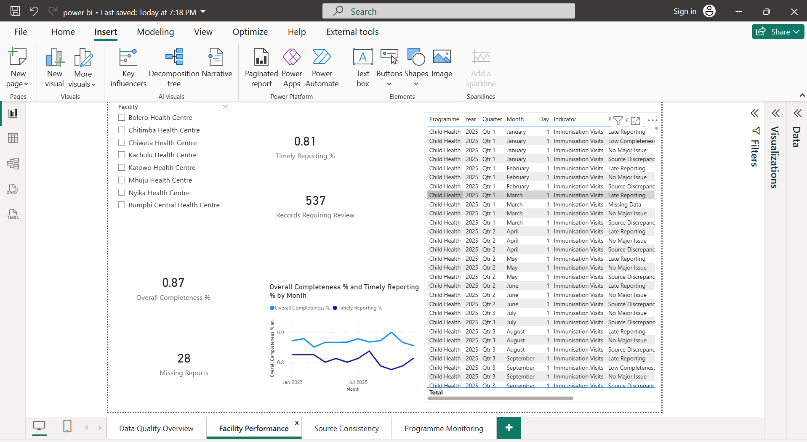
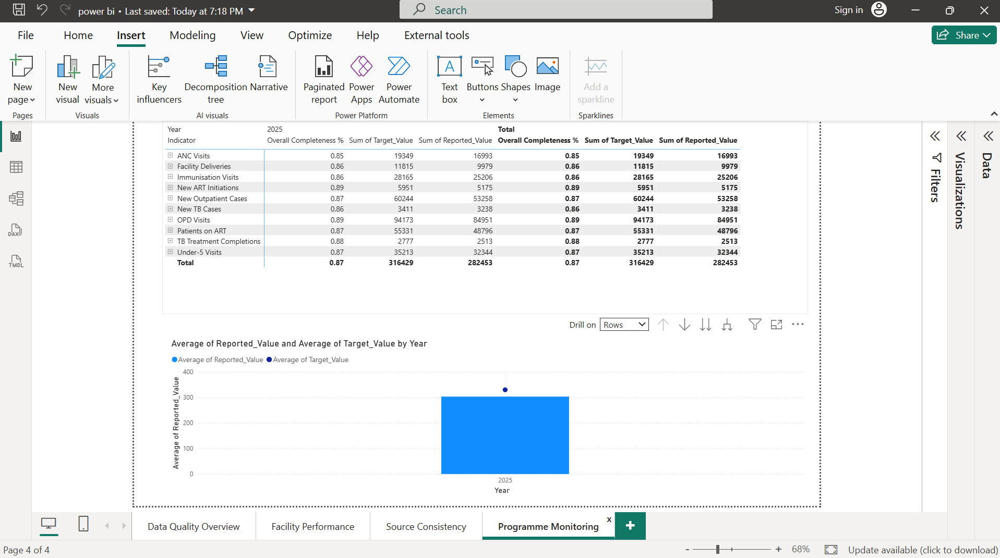

# Malawi Health Facility Data Intelligence & Performance Monitoring Platform

## Project Overview

A portfolio-scale, reproducible health-facility data intelligence platform built around a fully synthetic Malawi-oriented reporting environment. It combines data engineering, data-quality assessment, longitudinal statistical monitoring, programme target-attainment analysis, facility and district intelligence, and operational planning scenarios in one Python, Streamlit, Jupyter and Power BI project.

The expanded default cohort models **120 synthetic facilities, six Malawi district labels, 60 monthly periods, eight programme areas and 40 indicators — 288,000 facility-month-indicator records**. The platform then stages and validates the data, evaluates controlled quality defects, produces analytical outputs, and runs planning modules for resources, commodities, cold-chain batches, equipment, infrastructure and workforce capacity.

**Data governance:** every facility record, facility identifier, population, observation, target, stock movement, asset, staffing profile, event, cost and planning output is synthetic. District names are geographic labels only; results do not describe actual Malawi districts, facilities or Ministry of Health performance. No patient-level or employee-level personal data is included. This is a portfolio prototype, not a production health information system or an operational clinical, staffing, engineering or procurement recommendation.

## Platform capabilities

- **Data engineering:** reproducible cohort generation, relational-style facility and reporting facts, staging, structural validation and quarantine.
- **Data quality:** completeness, source reconciliation, timeliness, outlier detection, risk prioritisation and synthetic detector evaluation.
- **Statistical monitoring:** robust peer-group anomaly detection, monthly issue-rate trends and retrospective denominator-aware control limits.
- **Programme intelligence:** indicator-specific target attainment at facility, district, programme and monthly grain, with valid-data denominators.
- **Operational planning:** constrained resource allocation, commodity stockout and replenishment scenarios, cold-chain and batch-expiry review, equipment maintenance and uptime, infrastructure resilience, and workforce capacity scenarios.
- **Decision support:** interactive Streamlit workspace with an integrated facility priority register combining data quality, resource gaps, operational resilience and supply/cold-chain review; persistent local corrective-action register with audit history; downloadable analytical outputs; notebook analysis; and a Power BI semantic-model implementation pack.
- **Integrated prioritisation methodology:** transparent equal-weighted synthetic screening, explicit time-scope labels, facility-population reconciliation and review-domain explanations. See [the methodology](docs/integrated_facility_priority_methodology.md).
- **Facility management drill-down:** inspect each facility's priority-domain scores, saved action history across reporting months, owners, root causes, deadlines, overdue status, resolution progress and field-level audit trail using the existing action register.\n- **Corrective-action management:** facility-level owner assignment, root-cause documentation, due dates, status tracking, overdue monitoring, CSV export and SQLite field-level audit history. See [the workflow documentation](docs/integrated_facility_corrective_action_workflow.md). The dashboard also reports district workload, resolution rates and monthly action throughput.

## Baseline demonstration

The repository began as a smaller **960-record Rumphi-oriented demonstration** covering eight fictional facilities and 12 months. Its original Power BI report and four page exports remain available as a baseline example. The expanded platform described above is the current development focus; the original PBIX has not yet been rebuilt to include the expanded semantic model.

## Problem Statement

Health programmes depend on accurate, complete and timely information for monitoring performance and supporting operational decisions. Where information is recorded across paper registers, electronic medical records and digital reporting platforms, differences between sources create data-quality problems: missing values, duplicate or inconsistent records, delayed reporting and unusual values. These issues make routine reporting less reliable and increase the effort required for verification and correction.

This project demonstrates an end-to-end analytical workflow that moves from synthetic raw reporting data through validation and monitoring to prioritised review outputs and illustrative operational planning scenarios.

## Objectives

1. Build a reproducible, multi-year synthetic health reporting dataset.
2. Validate reporting structures and quarantine structural failures.
3. Measure completeness, consistency, timeliness and validity.
4. Evaluate quality detectors against controlled synthetic defects without leaking ground-truth labels into operational scoring.
5. Monitor facility, district, programme and indicator patterns over time.
6. Compare reported values with targets at like-for-like indicator grain.
7. Demonstrate constrained, transparent operational planning scenarios.
8. Deliver reusable outputs through Python, Streamlit, Jupyter and a Power BI implementation pack.

## Synthetic Dataset

The expanded generator produces 288,000 facility-month-indicator records by default: 120 synthetic facilities × 60 months × 8 programme areas × 5 indicators. It also creates a facility dimension and a generation manifest. The default seed and configuration make the cohort reproducible. Controlled quality defects and ground-truth labels support detector evaluation; ground truth is excluded from operational profiling and monitoring.

The original 960-row dataset is retained as a baseline demonstration and should not be confused with the expanded generated cohort. All data is synthetic and generated for portfolio demonstration only.

## Tools Used

Python (Pandas, NumPy, Matplotlib, Seaborn, Plotly, Streamlit) · Jupyter Notebook · Power BI

Python is used for reproducible data generation, validation, assessment and visualisation. The repository includes the implemented Power BI report and a Streamlit companion for browser-based exploration (see [`dashboard/`](dashboard/)).

## Project Workflow

```
Raw Synthetic Data → Data Inspection → Data Cleaning → Data Validation
    → Data Quality Assessment → Exploratory Analysis → Key Findings → Streamlit & Power BI Reporting
```

## Data Quality Dimensions

- **Completeness** — are required fields/records available? (`Calculated_Completeness`, calculated from actual field presence)
- **Consistency** — do the three reporting sources agree? (`Consistency_Flag`, using a 20% relative difference AND a 5-unit absolute difference threshold)
- **Timeliness** — was reporting completed on time? (`Calculated_Timeliness`, based on reporting dates vs. due dates)
- **Validity** — do reported values fall within a reasonable range? (`Outlier_Flag`, using IQR method grouped by indicator)

## Baseline demo findings (960-row dataset)

The following figures are calculated from the committed 960-row raw synthetic dataset using the current field-presence, timeliness, hybrid consistency and IQR rules. They describe this generated dataset only; they are not real Rumphi District or Ministry of Health results.

1. **Actual field completeness is 99.5%**, calculated from the presence of six required fields rather than the generator's simulated completeness score. Timely reporting is **80.8%** (776 of 960 records).
2. **271 of 960 records (28.2%)** have at least one quality flag under the current rules. This is the distinct-record count; issue counts overlap. The individual counts are 28 missing reported values, 184 late reports, 64 source reviews and 14 IQR outliers.
3. **Source consistency is 93.3%** (896 of 960 records) using the hybrid rule: for positive source minima, a review is raised only when the relative discrepancy exceeds 20% AND the absolute difference exceeds 5 units; when the minimum is zero, the absolute tolerance applies.
4. **Timeliness varies across facilities.** Kachulu Health Centre has the lowest on-time rate (74.2%), followed by Rumphi Central Health Centre (77.5%); Katowo Health Centre has the highest (85.0%).
5. **Calculated completeness is consistently high across facilities**, ranging from approximately 99.3% to 99.7%. Chiweta and Katowo are lowest; Rumphi Central and Nyika are highest. This illustrates why completeness should be calculated from actual required-field presence rather than a separate simulated score.
6. **The rate-normalised facility risk index** ranks Kachulu highest (8.1/100), followed by Rumphi Central (6.7) and Chitimba (6.6). The score gives equal weight to completeness shortfall, late reporting, source reviews, missing values and outliers. It is a follow-up prioritisation aid, not a validated facility-performance or clinical score.

The notebook reproduces these calculations and provides the detailed facility, programme and monthly breakdowns.

## Dashboard and Outputs

The project includes two complementary dashboard experiences:

[](https://health-facility-data-quality-analysis.streamlit.app/)

**Live application:** [Health Facility Data Quality Workspace](https://health-facility-data-quality-analysis.streamlit.app/)

### Streamlit companion

- [CSV data dictionary and upload contract](docs/data_dictionary.md)
- [Operational workflow, quality rules and production-readiness gaps](docs/operational_workflow.md)

The deployed Streamlit workspace supports bundled demonstration data, a downloadable CSV upload template and user-uploaded CSV assessment with schema/value intake checks, facility and programme filters, reporting-period filtering, executive quality metrics, volume-normalised facility risk prioritisation, programme/indicator monitoring, three-source reconciliation, a multi-issue record register, corrective-action ownership/status/notes, and CSV exports. Corrective-action assignments are persisted to a local SQLite database with field-level audit history. On Streamlit Community Cloud the local filesystem is ephemeral and not shared across instances, so the register should be downloaded regularly; managed multi-user persistence is not configured.

Run locally from the repository root:

```bash
pip install -r requirements.txt
streamlit run dashboard/streamlit_app.py
```

The app prefers `data/raw/synthetic_health_facility_data.csv` and falls back to the processed export only if the raw file is unavailable. Uploaded CSVs must include Facility, Programme, Indicator, Month, Reported_Value, Target_Value, Data_Source, Paper_Value, EMR_Value and DHIS2_Value. The shared `src/reporting.py` pipeline validates the intake, normalises numeric/date fields, recalculates completeness from field presence, applies the hybrid source-consistency and IQR outlier rules, and builds facility and issue summaries. If both `Submission_Date` and `Deadline_Date` are supplied, timeliness is calculated from those actual dates; otherwise the bundled synthetic `Timeliness` field is used. Records with fewer than two available source values are marked `Unknown Sources`, not silently counted as consistent. The source-reconciliation tab explains the production hybrid threshold and its limitations. The risk index is a transparent prioritisation aid, not a validated facility-performance score. This is a synthetic-data portfolio implementation, not a production health-information system.

#### Deploy on Streamlit Community Cloud

1. Sign in to [Streamlit Community Cloud](https://share.streamlit.io/) with the GitHub account that can access this repository.
2. Select **Create app**, choose this repository and the `main` branch.
3. Set the **Main file path** to `dashboard/streamlit_app.py`.
4. Deploy. Streamlit installs packages from the repository `requirements.txt`.
5. If deployment reports a missing file or dependency, use the app's **Manage app** logs to identify and resolve the issue before sharing the URL.

The repository includes automated tests for the reporting intake pipeline, expanded planning modules and a Streamlit `AppTest` smoke test in CI. These tests are intended to verify core logic and app rendering; they are not a substitute for a visual browser review of the deployed app. **Current validation status:** the latest expanded feature branch has not yet completed a successful CI run because GitHub Actions runner allocation is blocked by the repository billing limit. Treat the expanded branch as unvalidated until the release checklist is completed.

### Power BI report

The repository contains a **completed baseline Power BI report** for the original 960-record demonstration. The expanded 288,000-record platform has a separate semantic-model implementation pack, including Power Query templates, DAX measures and a thirteen-page report specification; the expanded PBIX has **not** yet been assembled or refreshed in Power BI Desktop.

- Power BI file: [dashboard/health_facility_data_quality_dashboard.pbix](dashboard/health_facility_data_quality_dashboard.pbix)
- Dashboard documentation: [dashboard/powerbi_dashboard_documentation.md](dashboard/powerbi_dashboard_documentation.md)
- Expanded model, query and DAX implementation specification: [dashboard/powerbi_expanded_model.md](dashboard/powerbi_expanded_model.md)
- Expanded thirteen-page report build guide: [dashboard/powerbi_report_build_guide.md](dashboard/powerbi_report_build_guide.md)
- Release gate and manual verification steps: [docs/release_validation_checklist.md](docs/release_validation_checklist.md)
- Data Quality Overview: [dashboard/Data_Quality_Overview.png](dashboard/Data_Quality_Overview.png)
- Facility Performance: [dashboard/Facility_Performance.png](dashboard/Facility_Performance.png)
- Source Consistency: [dashboard/Source_Consistency.png](dashboard/Source_Consistency.png)
- Programme Monitoring: [dashboard/Programme_Monitoring.png](dashboard/Programme_Monitoring.png)

### Power BI report screenshots

These are existing exports of the four Power BI report pages, not screenshots of the Streamlit app.







The Python analysis and data preparation workflow is available in [notebooks/health_data_quality_analysis.ipynb](notebooks/health_data_quality_analysis.ipynb).

## Decision-Making Use Case

A Monitoring & Evaluation Officer could use the dashboard to prioritise follow-up. For example: a facility shows low completeness for HIV reporting and repeated Paper/DHIS2 disagreement. The officer could identify the affected months, review source documents, contact the responsible facility staff, correct the reporting issue, and monitor that facility in subsequent cycles. This is what turns the dashboard from a reporting tool into a data-quality monitoring tool.

## Project Structure

```
health-facility-data-quality/
├── data/
│   ├── raw/
│   │   └── synthetic_health_facility_data.csv       # As generated, before cleaning
│   └── processed/
│       └── health_facility_data_processed.csv       # Cleaned + all quality flags added
├── notebooks/
│   └── health_data_quality_analysis.ipynb           # Full reproducible analysis workflow
├── docs/
│   ├── data_dictionary.md                           # CSV schema and validation contract
│   └── operational_workflow.md                      # Assessment rules and governance notes
├── dashboard/
│   ├── health_facility_data_quality_dashboard.pbix  # Finished Power BI dashboard
│   ├── streamlit_app.py                             # Interactive Streamlit companion
│   ├── Data_Quality_Overview.png                     # Dashboard page export
│   ├── Facility_Performance.png                      # Dashboard page export
│   ├── Programme_Monitoring.png                      # Dashboard page export
│   ├── Source_Consistency.png                        # Dashboard page export
│   └── powerbi_dashboard_documentation.md           # Implementation and design guide
├── src/
│   ├── reporting.py                                  # CSV intake and reusable reporting workflow
│   ├── data_generator.py                             # Synthetic data generation module
│   └── data_quality.py                              # Data quality assessment functions
├── tests/
│   ├── test_data_quality.py                          # Automated tests for data quality rules
│   ├── test_reporting.py                              # Intake and assessment pipeline tests
│   └── test_streamlit_app.py                          # Streamlit rendering smoke test
├── visuals/
│   └── charts/                                       # Chart exports from the notebook
├── .github/workflows/quality-checks.yml             # Automated CI checks
├── .streamlit/config.toml                            # Accessible light theme
├── requirements.txt
└── README.md
```

**What belongs where:** `data/` holds the raw synthetic and processed datasets; `notebooks/` contains the reproducible analysis; `docs/` defines the upload contract and operational workflow; `dashboard/` contains the Power BI report, exports and Streamlit workspace; `src/` contains reusable data generation, assessment and reporting logic; `tests/` covers quality rules, intake/assessment behaviour and app rendering; `visuals/charts/` holds notebook chart exports.

## How to Run

Install dependencies and launch the Streamlit companion from the repository root:

```bash
pip install -r requirements.txt
streamlit run dashboard/streamlit_app.py
```

To reproduce the analysis, launch Jupyter from the repository root. The notebook resolves the project paths automatically whether it is opened from the root or the `notebooks/` directory:

```bash
git clone https://github.com/MkandawireChico/Health-facility-data-quality-analysis-using-synthetic-data-.git
cd Health-facility-data-quality-analysis-using-synthetic-data-
pip install -r requirements.txt
jupyter notebook notebooks/health_data_quality_analysis.ipynb
# Run all cells from top to bottom to regenerate the synthetic data,
# calculate quality metrics and refresh the exported charts.

# Run the automated tests from the repository root:
pytest -q
```

## Ethical Considerations

This project uses entirely synthetic data. No real patient information, patient identifiers, or actual facility records are used at any point. Facility names and all numerical results exist solely to demonstrate the workflow. This project does not claim to represent actual Ministry of Health, DHIS2, or Rumphi District facility performance.

## Portfolio Relevance

Demonstrates skills relevant to: Data Technician · Data Analyst · Monitoring & Evaluation Assistant · Health Information Systems Assistant · M&E Data Officer · Research Data Assistant · Health Informatics roles — specifically the ability to move from raw, imperfect data to validated information and a prioritized, actionable output.

## Remaining validation and future work

- Capture genuine screenshots of the expanded Streamlit workspace after completing a visual browser QA pass
- Validate the statistical thresholds and peer-group assumptions against appropriately governed operational data before any real-world use
- Execute the complete automated test suite and full default platform build after GitHub Actions runner capacity is restored
- If properly anonymised and aggregated operational reporting data ever becomes available for a comparable workflow, assess whether the synthetic patterns generalise

## Author

Chico Mkandawire
MSc Data Science, Malawi University of Science and Technology (in progress)
BSc Management Information Systems, Malawi University of Business and Applied Sciences


## Expanded Health Data Intelligence Platform

The project is being expanded beyond the original 960-row demonstration into a reproducible, multi-year synthetic health reporting platform. The target cohort is 120 synthetic facilities across six Malawi-oriented district labels, 60 monthly periods, eight programme areas and 40 indicators — **288,000 facility-month-indicator records**.

- [Expanded platform build blueprint](docs/data_platform_blueprint.md)
- [Scalable synthetic data generator](src/scale_data_generator.py)
- [Generator test suite](tests/test_scale_data_generator.py)

Generate the expanded cohort locally with `python src/scale_data_generator.py`. The generated fact table, facility dimension and run manifest are written under `data/warehouse/raw/`. Generated CSVs are reproducible from the fixed seed and configuration and are intentionally not committed as large generated files. All records are synthetic and do not represent actual facility performance.


### Staging and data-quality pipeline

After generating the raw cohort, run `python src/etl_pipeline.py` to normalize and stage the reporting fact against the facility dimension. Structural failures (such as unknown facilities, invalid periods and duplicate natural keys) are written to quarantine; analytical quality issues remain in the staged data with explicit flags. A JSON quality report summarizes staging yield and issue counts.

Outputs: `data/warehouse/staged/facility_reporting_staged.csv`, `facility_reporting_quarantine.csv` and `staging_quality_report.json`.

The pipeline implementation is in [src/etl_pipeline.py](src/etl_pipeline.py), with automated coverage in [tests/test_etl_pipeline.py](tests/test_etl_pipeline.py).


### Detector evaluation and longitudinal analytics

Run `python src/quality_analytics.py` after staging to evaluate the missing-value, source-discrepancy, outlier and timeliness detectors against the generator's synthetic ground-truth labels. The evaluation reports confusion counts, precision, recall, F1, specificity, false-positive rate and accuracy. The same command writes monthly trends, facility benchmarks and programme/indicator profiles under `data/warehouse/analytics/`.

Ground-truth labels are used only to calculate evaluation metrics. Operational predictions, monthly trends and facility/programme profiles do not use those labels. Metrics describe performance against controlled synthetic defects, not validated performance on real health reporting data. The outlier rule is Reported_Value / Target_Value > 1.5.

Implementation: [src/quality_analytics.py](src/quality_analytics.py). Tests: [tests/test_quality_analytics.py](tests/test_quality_analytics.py).

Full local workflow:

```bash
python src/scale_data_generator.py
python src/etl_pipeline.py
python src/quality_analytics.py
python src/statistical_monitoring.py
pytest -q
```


### Statistical anomaly and process monitoring

The additional statistical monitoring layer is available in
[`src/statistical_monitoring.py`](src/statistical_monitoring.py). It applies
MAD robust-z and IQR fallback checks within month/district/programme/indicator
peer groups, then builds retrospective monthly issue-rate monitoring with pooled-rate, denominator-aware retrospective p-chart
limits. Run it after staging with `python src/statistical_monitoring.py`.
Statistical signals are verification prompts, not proof of errors; the control
limits are retrospective descriptive limits, not a prospective alerting service. The
monitoring code does not use synthetic ground-truth labels.


### Expanded platform Streamlit workspace

The Streamlit app now includes an **Expanded platform** tab. Upload a staged
multi-year reporting CSV to view monthly issue trends, facility follow-up rates,
programme/indicator profiles, MAD/IQR peer anomalies and retrospective monthly
issue-rate monitoring with a denominator-aware retrospective p-chart visual. If synthetic ground-truth labels are present, the page
also reports detector evaluation metrics; without those labels it deliberately
does not invent precision or recall values.

Generate the staged cohort locally before uploading:

```bash
python src/scale_data_generator.py
python src/etl_pipeline.py
```

Then upload `data/warehouse/staged/facility_reporting_staged.csv` in the app.
The upload and resulting analysis remain session-scoped; shared database
persistence is not configured. The Expanded Platform page also provides a
one-click ZIP export containing the management summary, monthly/facility/
programme/district profiles, peer anomalies, monthly control-chart output and
synthetic-only detector evaluation metrics when labels are available. The
expanded generated data is not committed to the repository.


### Expanded analytical notebook

The Jupyter notebook now follows the expanded data platform end to end:
generation, source validation, staging/quarantine, detector evaluation,
longitudinal profiles, statistical peer anomalies and monthly monitoring.
It exports reproducible artefacts under `data/warehouse/` (ignored by Git)
and explicitly checks that operational predictions are unchanged when
synthetic ground-truth columns are removed. Run it from the repository root
after installing dependencies; the default run processes all 288,000 records.


### One-command full platform build

The repository includes an orchestration command that runs generation,
staging/quarantine, detector evaluation, operational profiling and statistical
monitoring in sequence:

```bash
python src/build_platform.py
```

By default it builds the full 288,000-record cohort and writes reproducible
outputs under the Git-ignored `data/warehouse/` directory. Use
`--facilities`, `--periods`, `--seed` and `--output-dir` to configure a
smaller or alternate run. The end-to-end unit test uses a small cohort; the
separate GitHub Actions **Platform build** workflow (`platform-build.yml`)
runs the full default cohort and publishes generated validation artefacts as a short-lived
workflow artifact.


### Expanded Power BI semantic model pack

The expanded platform includes a separate Power BI implementation pack:
[`dashboard/powerbi_expanded_model.md`](dashboard/powerbi_expanded_model.md).
It documents the star schema, relationship design, expanded thirteen-page report plan (with an optional facility-detail page) and
synthetic-data governance. The accessible light theme is in
[`dashboard/powerbi_theme.json`](dashboard/powerbi_theme.json), and the report
build and visual QA guide is in
[`dashboard/powerbi_report_build_guide.md`](dashboard/powerbi_report_build_guide.md).
Reusable DAX measures are in
[`dashboard/dax/health_data_quality_measures.dax`](dashboard/dax/health_data_quality_measures.dax)
and calculated dimensions in
[`dashboard/dax/dimension_tables.dax`](dashboard/dax/dimension_tables.dax).
Power Query M templates for the reporting fact, dimensions, source observations,
district intelligence, monthly trends, statistical anomalies, detector
evaluation, target attainment, resource allocation, commodity supply, cold-chain,
equipment, infrastructure and workforce facts are in `dashboard/powerquery/`. Target-attainment calculations and interpretation
safeguards are documented in
[`docs/target_attainment_methodology.md`](docs/target_attainment_methodology.md).

This is an implementation pack for rebuilding the expanded semantic model in
Power BI Desktop. The existing PBIX remains the original 960-row report until
the new model and pages are applied and exported from Power BI Desktop.


### Corrective action persistence and audit trail

The action register uses `src/action_store.py` to persist owners, root causes,
corrective actions, due dates and statuses in SQLite. Every changed field is
recorded in an audit-history table. The default local database path is
`data/warehouse/corrective_actions.sqlite`; override it with the
`HEALTH_DATA_ACTION_DB` environment variable. The warehouse directory is
Git-ignored.

This provides durable local persistence when running the app on a persistent
machine. Streamlit Community Cloud's local filesystem is ephemeral and does
not provide shared multi-user storage, so download backups regularly. A
production deployment should use a managed database, authentication,
role-based permissions and retention controls.


### District-level quality intelligence

The expanded operational analytics now include district and district-month
profiles: volume, distinct facilities, detected issue counts and rates by
district. These are generated from operational quality flags only; synthetic
ground-truth labels are not used in district rankings or trend profiles.
The Streamlit Expanded Platform page displays district issue-rate comparisons,
reporting volume and monthly trends, with CSV exports. District names are
geographic labels for a synthetic scenario and do not represent actual
district or Ministry of Health performance.

### Target attainment and programme performance

The new `src/target_attainment.py` layer calculates pooled reported-to-target
attainment at facility-indicator, district-indicator, programme-indicator and
month-indicator grain. Values are compared only within the same programme and
indicator; the platform does not aggregate unlike service indicators into a
single facility score. Missing/invalid months, missing or negative reported
values, and missing/non-positive targets are excluded from both numerator and
denominator, with valid-data percentages retained. Illustrative review bands
are below 80%, 80–99.9%, and at/above 100%; they are not official Malawi service
standards. These outputs are not population coverage or unique people served.
The Streamlit Expanded Platform now includes under-target facility-indicator
review, district comparisons, monthly indicator trends and CSV/ZIP exports.
Power BI query templates are provided for facility, district and monthly
attainment facts. All underlying records and targets remain synthetic.

### Corrective action workflow improvements

Corrective action IDs are now stable across dataframe sorting and filter
changes, and namespaced by source file. The register displays all saved
actions—not only currently visible flagged rows—with status totals, overdue
counts, full-register export and field-level audit history. Local SQLite
persistence remains single-instance/local; Streamlit Community Cloud storage
is ephemeral and is not a managed multi-user database.


### Resource capacity planning and allocation scenarios

The new `src/resource_planning.py` layer creates synthetic facility capacity profiles and compares three constrained allocation heuristics: largest-gap priority, rural-weighted equity and equal-share rounds. The pool is configurable and every strategy respects each facility's modelled gap. Outputs include baseline capacity, abstract requirement units, allocated units, residual gaps and scenario summaries. These are explicitly illustrative resource units—not staff headcounts, budgets, official Malawi staffing norms or operational recommendations. Catchment population is only a configurable planning proxy, not patient volume or service coverage. See `docs/resource_planning_methodology.md`. The one-command platform build now exports the resource planning tables and report; Streamlit includes a scenario laboratory and CSV downloads.

### Commodity availability and replenishment intelligence

The new `src/supply_chain_planning.py` module simulates monthly stock cards for eight illustrative commodities across the synthetic facility dimension. It calculates stock balances, fulfilled and unmet demand, estimated stockout days, days of cover and replenishment requirements based on a configurable lead-time-plus-buffer assumption. A deterministic priority-per-credit routine allocates a configurable abstract budget ceiling and exposes funded and unfunded units. The one-command platform build exports the commodity catalogue, stock ledger, replenishment plan and summary; Streamlit adds stockout trends, a commodity risk table and a downloadable replenishment worklist.

All commodity records, demand, receipts and unit costs are synthetic. The commodity list is illustrative, budget credits are not MWK, and this is not an approved national catalogue or operational procurement recommendation. See `docs/supply_chain_methodology.md`.


### Cold-chain, batch traceability and expiry intelligence

The new `src/cold_chain_planning.py` module creates synthetic facility-month temperature monitoring and batch-level inventory histories for four illustrative temperature-sensitive commodity labels. It records synthetic sensor coverage and excursion summaries, lot identifiers, supplier identifiers, manufacture/receipt/expiry dates, FEFO consumption, batch balances, expired quantities and near-expiry stock at 30/60/90 days. A transparent review score combines observed excursion-day rate and the share of closing stock expiring within 90 days.

The one-command platform build exports a cold-chain catalogue, temperature monitoring fact, batch ledger, expiry-risk summary and report. Streamlit adds a cold-chain risk dashboard and downloadable batch review worklist. The notebook and Power BI model include the same analysis layer.

All records, sensors, lots, temperatures, suppliers, receipts, consumption and expiry events are synthetic. The default 2–8°C band and shelf lives are illustrative assumptions, not official Malawi standards or product-specific storage instructions. The monthly temperature summary is not validated continuous logger evidence and cannot determine product disposition. See `docs/cold_chain_methodology.md`.


### Equipment asset, maintenance and uptime intelligence

The new `src/equipment_maintenance.py` module creates a synthetic equipment register and asset-month history for seven illustrative equipment types. It models preventive-maintenance schedules, corrective work orders, breakdown events, unplanned and planned downtime, service availability, operational uptime, condition scores and a transparent equipment review score. Work-order cost credits reconcile to monthly maintenance costs.

The platform build exports the equipment catalogue, asset register, asset-month performance, facility-month summaries, maintenance work orders, latest asset-risk snapshot and a methodology report. Streamlit adds uptime trends, PM completion monitoring, high-risk asset review and work-order exports. The notebook and Power BI model include the same layer.

All assets, failures, maintenance events, condition scores and costs are synthetic. Asset lives, failure probabilities, maintenance intervals and criticality weights are illustrative assumptions, not official standards or verified engineering guidance. Abstract credits are not MWK. This is not a verified facility inventory or clinical service-availability report. See `docs/equipment_maintenance_methodology.md`.


## Facility infrastructure and utilities intelligence

The expanded platform now includes a synthetic infrastructure reliability layer covering power interruptions and backup response, water shortages and storage buffering, connectivity downtime, monthly domain availability, a composite resilience review score, descriptive comparisons with simulated equipment uptime, and illustrative facility upgrade scenarios under an abstract credit ceiling.

See [infrastructure reliability methodology](docs/infrastructure_reliability_methodology.md). All infrastructure configurations, interruptions, scores, and upgrade assumptions are synthetic. They are not utility-provider observations, engineering assessments, verified clinical service availability, or procurement advice. Abstract credits are not MWK.


## Workforce capacity and staffing intelligence

A further synthetic planning layer models facility-role establishments, filled and vacant posts, monthly absence and overtime, catchment-based workload proxies, facility coverage review bands, and a role-level recruitment scenario under an abstract credit ceiling. The role categories and weights are illustrative, not official Malawi staffing norms. No employee or patient records are generated. Catchment population is not patient volume; recruitment credits are not MWK. See [workforce planning methodology](docs/workforce_planning_methodology.md).


### Reproducible full-platform build and deployment notes

For the complete analytical platform (not just the original CSV assessment
workflow), install the pinned-by-range project dependencies and run the
orchestrator from the repository root:

```bash
python -m pip install --upgrade pip
python -m pip install -r requirements.txt
python src/build_platform.py
pytest -q
```

The default build creates 120 synthetic facilities, 60 monthly periods and
288,000 facility-month-indicator fact records. It writes raw, staged, quarantine
and analytical outputs beneath `data/warehouse/`, which is intentionally
excluded from version control. For a quick development run, use a smaller
cohort, for example:

```bash
python src/build_platform.py --facilities 12 --periods 6 --output-dir data/warehouse-smoke
```

The platform build summary is written to
`data/warehouse/platform_build_summary.json`. Its `outputs` object is the
artifact manifest; each listed path should exist after a successful build.
The build includes synthetic resource, commodity, cold-chain, equipment,
infrastructure and workforce scenarios. These modules use explicit
illustrative assumptions and abstract credits, not official standards,
verified facility observations or Malawi Kwacha budgets.

The Streamlit app is launched separately:

```bash
streamlit run dashboard/streamlit_app.py
```

The Streamlit Community Cloud deployment linked above is a hosted app and
should not be assumed to reflect unmerged feature branches. The expanded
platform code and Power BI semantic-model pack require successful CI,
deployment refresh and a visual verification pass before they can be described
as live and fully validated. The existing PBIX remains the original report
until the expanded semantic model is rebuilt and saved from Power BI Desktop.


The final release gate and ordered merge procedure are documented in
[`docs/release_validation_checklist.md`](docs/release_validation_checklist.md).

The final repository-wide audit, PR dependency review and remaining release blockers are recorded in [`docs/final_repository_audit.md`](docs/final_repository_audit.md).
